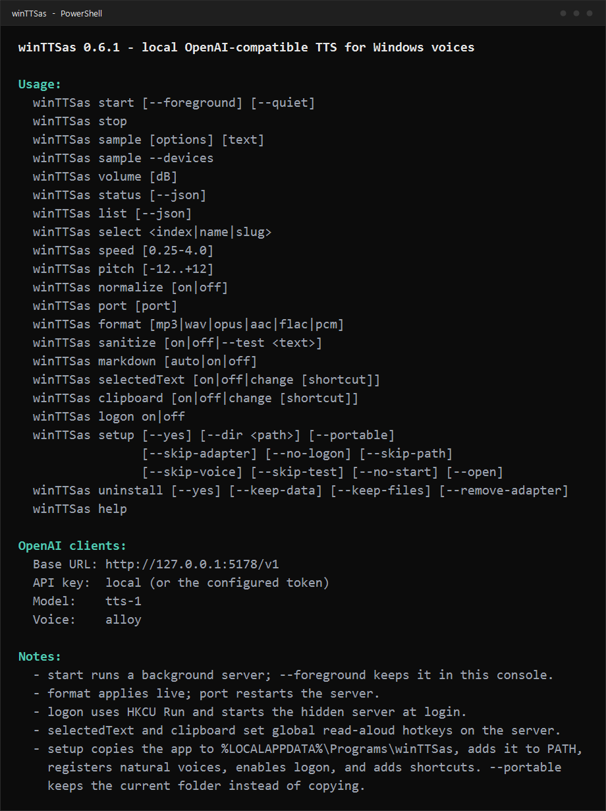
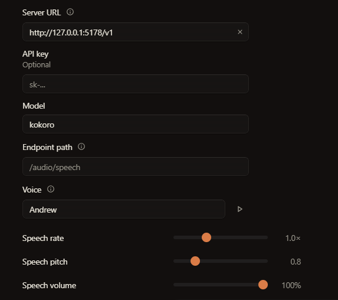
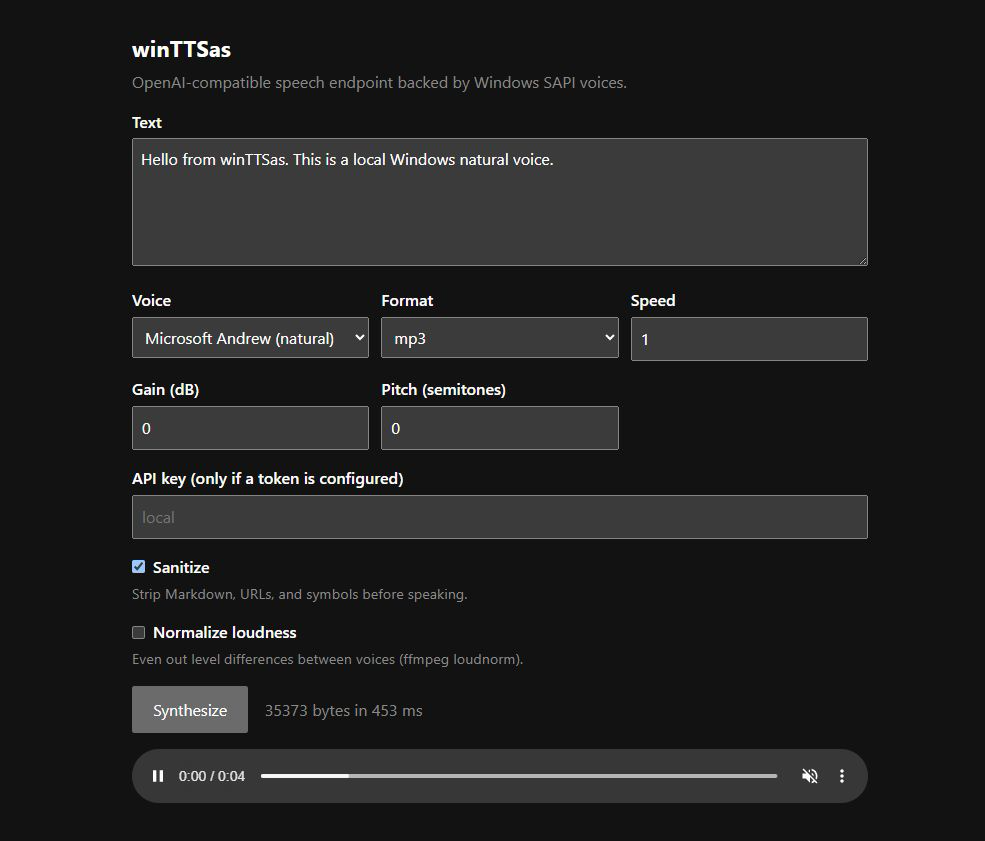

# winTTSas

**Pronunciation:** win - tee tee - es ae es.

Local, OpenAI-compatible text-to-speech for Windows. winTTSas serves the voices
already installed on the machine through `/v1/audio/speech`, so any OpenAI TTS
client can use them without cloud calls, accounts, or API keys.

[](https://github.com/Magid-William/winTTSas/releases/latest)
[](LICENSE)
[](docs/reference.md#requirements)
[](docs/reference.md)

```text
client -> POST /v1/audio/speech -> winTTSas -> System.Speech (SAPI5)
                                            -> NaturalVoiceSAPIAdapter -> Narrator
```

<p align="center">
  
</p>

<p align="center"><em><code>winTTSas help</code> — every command, one screen.</em></p>

<p align="center">
  
</p>

<p align="center"><em>Any OpenAI voice client works: server URL, endpoint path, voice.</em></p>

## Table of contents

- [Introduction](#introduction)
- [Installation](#installation)
- [Usage](#usage)
  - [In another application](#in-another-application)
  - [Read aloud from anywhere](#read-aloud-from-anywhere)
  - [Speak or save one line](#speak-or-save-one-line)
- [API](#api)
  - [CLI](#cli)
  - [Server](#server)
- [Recipes](#recipes)
- [How it works](#how-it-works)
- [Troubleshooting](#troubleshooting)
- [Documentation](#documentation)
- [Licenses](#licenses)

## Introduction

Windows already ships with speech voices, and Narrator adds natural-sounding
ones. winTTSas turns those voices into a small local web service that speaks
OpenAI's text-to-speech protocol (`POST /v1/audio/speech`). Programs that
support a custom OpenAI server — editors, note apps, readers, chat frontends —
can then read text aloud with the voices you already have.

There is no account, no key to buy, and no audio leaving the machine. The
service listens on `127.0.0.1` only and keeps its config, cache, and logs under
`%APPDATA%` and `%LOCALAPPDATA%`.

It is also useful on its own: one shortcut reads the selected text in any
application, and one command turns a line of text into a file.

### Highlights

- **Any OpenAI TTS client.** Point the base URL at
  `http://127.0.0.1:5178/v1` and use `local` as the API key.
- **The voices Windows already has.** Classic SAPI voices work immediately;
  Narrator natural voices come through the bundled NaturalVoiceSAPIAdapter.
- **Six output formats.** `mp3`, `wav`, `opus`, `aac`, `flac`, and `pcm`,
  produced by the bundled ffmpeg.
- **Tunable delivery.** Speed, pitch in semitones, gain, and optional loudness
  normalization, per request or as defaults.
- **Read aloud from anywhere.** `Ctrl+Alt+R` reads the selection, `Ctrl+Alt+C`
  reads the clipboard, and pressing the shortcut again stops.
- **Friendly to scripts.** `sample` speaks or saves one line, URL routes
  synthesize without a JSON body, and `status --json` reports the real values.
- **Installed by one command.** `winTTSas setup` puts the command on `PATH`,
  registers natural voices, and starts the server at login.
- **Nothing to babysit.** One hidden background process, config hot-reload, and
  a local WAV cache.

## Installation

The release is portable and needs Windows 10 or 11 on x64, nothing else. The
.NET runtime and ffmpeg are bundled, so there is nothing to download after the
zip. The setup wizard additionally installs the command for the current user
and does not need admin rights, except for one optional natural-voice step.

**1. Download and extract the release.** Grab `winTTSas.zip` from
[Releases](https://github.com/Magid-William/winTTSas/releases/latest) and
extract it anywhere, for example your Downloads folder or `C:\Tools\winTTSas`.

```text
winTTSas\
  winTTSas.exe                    the command
  winTTSas-server.exe             hidden HTTP server
  tools\ffmpeg\ffmpeg.exe         bundled transcoder
  tools\NaturalVoiceSAPIAdapter\  natural voice adapter
  scripts\install-adapter.ps1
  docs\                           reference and client notes
  licenses\
```

**2. Run the setup wizard** from the folder you extracted into:

```powershell
.\winTTSas.exe setup
```

The wizard walks through these steps, and pressing Enter accepts the default at
every prompt:

| Step | What it does |
|---|---|
| Install folder | Copies the release to `%LOCALAPPDATA%\Programs\winTTSas` |
| Natural voices | Registers the adapter (one UAC prompt); classic voices need nothing |
| PATH | Adds the install folder to the user `PATH`, no admin needed |
| Start at login | Starts the hidden server and enables startup at login |
| Default voice | Shows the installed voices and asks which one to use |
| Test speech | Speaks a sentence on the default output device |
| Shortcuts | Adds a Start Menu shortcut and an Apps & Features entry |

The wizard is idempotent: running it again upgrades the installed copy, keeps
your settings, and never duplicates the `PATH` entry. Afterwards the extracted
zip can be deleted.

**3. Open a new terminal.** Existing terminals keep their old `PATH`.

```powershell
winTTSas status
winTTSas list
```

The server listens on `http://127.0.0.1:5178`; `status` prints the effective
settings, including the hotkeys and the log location.

**4. Hear it.**

```powershell
winTTSas sample "Hello from winTTSas."
```

Silent? `winTTSas sample --devices` lists the output devices; pass one with
`--device <n>`.

**5. Open the test page:** <http://127.0.0.1:5178/>.

### Setup without prompts

```powershell
winTTSas setup --yes                        # accept every default
winTTSas setup --yes --dir D:\Tools\winTTSas
winTTSas setup --yes --portable             # keep the files where they are
winTTSas setup --yes --skip-adapter         # classic SAPI voices only
```

| Flag | Effect |
|---|---|
| `--yes` | Accept every default; no prompts and no test speech |
| `--dir <path>` | Install folder (default `%LOCALAPPDATA%\Programs\winTTSas`) |
| `--portable` | Keep the current folder instead of copying |
| `--skip-adapter` | Do not touch natural voice registration |
| `--no-logon` | Do not start the server at login |
| `--skip-path` | Do not change `PATH` |
| `--skip-voice` | Keep the current default voice |
| `--skip-test` | Do not speak a test sentence |
| `--no-start` | Do not start the server now |
| `--open` | Open the test page at the end |

Scripts must pass `--yes`: the wizard refuses to prompt when standard input is
redirected. The [reference](docs/reference.md#install-with-the-wizard) walks
through the same steps in more detail.

### Portable or manual install

Skipping the wizard is fine. Run the executable from the extracted folder:

```powershell
.\winTTSas.exe start
.\winTTSas.exe sample "Hello from winTTSas."
```

Or add the folder to `PATH` yourself, or run `setup --portable` to keep the
folder and let the wizard handle `PATH`, login startup, and shortcuts. The
[reference](docs/reference.md#manual-setup) has the manual walkthrough.

> The executables are unsigned. SmartScreen may warn on first run; choose
> **More info > Run anyway**. `setup` clears the downloaded-file mark from the
> files it installs, so Windows stops asking after that.

### Natural voices (optional)

Classic SAPI voices (David, Zira, ...) work immediately. For Narrator's modern
voices, install them in Windows first: **Settings > Accessibility > Narrator >
Add natural voices**. `setup` registers the SAPI adapter for you; to do it
later, or again after moving the app, run once from an elevated PowerShell:

```powershell
.\scripts\install-adapter.ps1
```

`winTTSas list` shows a `Natural` column. Keep
`tools\NaturalVoiceSAPIAdapter` in place after registering it.

### Uninstall

```powershell
winTTSas uninstall                    # confirm, then remove everything
winTTSas uninstall --yes --keep-data  # keep config, cache, and logs
winTTSas uninstall --yes --keep-files # keep the program folder
```

Uninstall stops the server and removes the logon entry, the `PATH` entry, the
Start Menu shortcut, and the Apps & Features entry, then deletes config, cache,
logs, and the program folder. Use `--keep-data` and `--keep-files` to keep any
of that, and `--remove-adapter` to unregister natural voices as well. The same
uninstaller is behind the Apps & Features **Uninstall** button.

## Usage

### In another application

Most clients ask for an OpenAI-compatible base URL. Use:

```text
Base URL: http://127.0.0.1:5178/v1
API key:  local          # ignored unless a token is configured
Model:    tts-1
Voice:    alloy
```

Some clients ask for a server URL and an endpoint path separately, like the
client in the screenshot above:

```text
Server URL:    http://127.0.0.1:5178/v1
Endpoint path: /audio/speech
```

Others want one raw URL. Paste either the whole endpoint,
`http://127.0.0.1:5178/v1/audio/speech`, or put values in the path:
`http://127.0.0.1:5178/v1/audio/speech/voice/1/speed/1.2/text/Hello`.

The model name is accepted and ignored, so any value works; `tts-1` is the safe
choice. Voice names, ranges, and the per-request fields are described in the
[server API](#server); client snippets for Python, Node, and PowerShell are in
[docs/openai-clients.md](docs/openai-clients.md).

### Read aloud from anywhere

While the server runs, two global shortcuts work in any application:

| Shortcut | Action |
|---|---|
| `Ctrl+Alt+R` | Read the selected text aloud |
| `Ctrl+Alt+C` | Read the clipboard aloud |

Press either shortcut while speech is playing to stop it. The selection is
copied with `Ctrl+C`, then the previous plain-text clipboard is restored, so
copying something else is not disturbed.

```powershell
winTTSas selectedText               # show the chord and whether it is active
winTTSas selectedText off           # disable it, keep the chord
winTTSas selectedText change        # press the new chord; Esc cancels
winTTSas clipboard ...              # same forms for the clipboard
```

Reads use the same voice, speed, pitch, gain, normalization, and sanitization
as the API. Both chords are shown by `winTTSas status`.

### Speak or save one line

```powershell
winTTSas sample "Hello there."
winTTSas sample --save out.wav "Hello there"
```

`sample` plays through the local sound card unless `--save` (alias `-o`) writes
a file. The format comes from the file extension, or from `--format`. Options
can appear before or after the text:

```powershell
winTTSas sample --voice andrew --speed 1.2 --save out.flac "Hello there"
```

## API

### CLI

`winTTSas help` prints the built-in summary:

```text
winTTSas 0.6.1 - local OpenAI-compatible TTS for Windows voices

Usage:
  winTTSas start [--foreground] [--quiet]
  winTTSas stop
  winTTSas sample [options] [text]
  winTTSas sample --devices
  winTTSas volume [dB]
  winTTSas status [--json]
  winTTSas list [--json]
  winTTSas select <index|name|slug>
  winTTSas speed [0.25-4.0]
  winTTSas pitch [-12..+12]
  winTTSas normalize [on|off]
  winTTSas port [port]
  winTTSas format [mp3|wav|opus|aac|flac|pcm]
  winTTSas sanitize [on|off|--test <text>]
  winTTSas markdown [auto|on|off]
  winTTSas selectedText [on|off|change [shortcut]]
  winTTSas clipboard [on|off|change [shortcut]]
  winTTSas logon on|off
  winTTSas setup [--yes] [--dir <path>] [--portable]
                 [--skip-adapter] [--no-logon] [--skip-path]
                 [--skip-voice] [--skip-test] [--no-start] [--open]
  winTTSas uninstall [--yes] [--keep-data] [--keep-files] [--remove-adapter]
  winTTSas help

OpenAI clients:
  Base URL: http://127.0.0.1:5178/v1
  API key:  local (or the configured token)
  Model:    tts-1
  Voice:    alloy
```

Commands that change a setting write `config.json` and hot-reload a running
server, so no restart is needed. `port` is the exception: it restarts the
server. `winTTSas version` prints the version.

#### Lifecycle

| Command | What it does |
|---|---|
| `winTTSas start` | Start the hidden server, or attach to a running one |
| `winTTSas start --foreground` | Run the server in this console; `Ctrl+C` stops it |
| `winTTSas start --quiet` | Start if needed and print only the base URL |
| `winTTSas stop` | Graceful shutdown, with a force-kill fallback |
| `winTTSas status` | State, PID, URL, voice, format, speed, pitch, normalization, hotkeys, queue, logon |
| `winTTSas status --json` | The same data as JSON |

```powershell
winTTSas start --quiet > url.txt
winTTSas status
winTTSas stop
```

#### Voices

| Command | What it does |
|---|---|
| `winTTSas list` | Table of installed SAPI voices, with a `Natural` column |
| `winTTSas list --json` | The same list as JSON |
| `winTTSas select <index\|name\|slug>` | Set the default voice |
| `winTTSas select` | Interactive picker |

```powershell
winTTSas list
winTTSas select 1
winTTSas select "Microsoft Andrew"
winTTSas select andrew
```

Requests resolve a voice in this order: 1-based index, `voiceMap` alias, exact
name, exact slug, Azure-style name, OpenAI alias (`alloy`, `nova`, ...),
substring match, then the default voice.

#### Defaults

These set the values used when a request does not override them. With no
argument, each command prints the current value.

| Command | Range | Default | Notes |
|---|---|---|---|
| `winTTSas speed [factor]` | 0.25-4.0 | `1.0` | Maps to SAPI rate -10..10 |
| `winTTSas pitch [semitones]` | -12..+12 | `0` | Shifts pitch, keeps duration |
| `winTTSas volume [dB]` | -24..+24 | `0` | Alias `gain`; applied with a limiter |
| `winTTSas normalize [on\|off]` | | `off` | Loudness normalization (`loudnorm`) |
| `winTTSas format [format]` | see below | `mp3` | Hot-reloaded, no restart |
| `winTTSas port [port]` | 1024-65535 | `5178` | Restarts the server |

```powershell
winTTSas speed 1.5
winTTSas pitch -2
winTTSas volume +3
winTTSas normalize on
winTTSas format mp3
winTTSas port 5200
```

`format` accepts `mp3`, `wav`, `opus`, `aac`, `flac`, or `pcm`; aliases such as
`ogg`, `m4a`, `wave`, and `s16le` are normalized.

`pitch` is a post-synthesis shift in semitones (positive is higher) using
ffmpeg's `rubberband` filter, so duration and speaking rate do not change.
Quality is best within about ±6; beyond that the voice starts to sound
synthetic.

`normalize` evens out loudness between voices with ffmpeg `loudnorm` (target
-16 LUFS, -1.5 dBTP). It runs before gain, so `volume` still works as a
relative trim on top.

`volume`/`gain` is a default for all requests, not a system volume control. It
is applied during transcoding with a lookahead limiter, so the cached raw WAV
is untouched and changing gain never invalidates the cache. Pitch and
normalization behave the same way.

#### Global hotkeys

| Command | Effect |
|---|---|
| `winTTSas selectedText` | Show the chord and whether it is active |
| `winTTSas selectedText on` | Re-enable the configured chord |
| `winTTSas selectedText off` | Unregister it, keep the chord |
| `winTTSas selectedText change` | Wait for the next chord you press; `Esc` cancels |
| `winTTSas selectedText change Ctrl+Shift+R` | Set the chord directly |
| `winTTSas clipboard ...` | Same forms for the clipboard |

Registration failures are reported instead of being silent: a chord that
Windows or another application already owns shows up in `change`, `on`, and
`status`. An invalid chord is kept verbatim in `config.json` so the error can
be read back. Hotkeys need the running server, so use `start` or `logon on`.

#### Sample playback

`sample` plays through the local sound card, or writes a file with `--save`,
and never changes config. Values resolve as `flag -> config -> built-in`.

| Option | Meaning |
|---|---|
| `--speed <0.25-4.0>` | Speed for this sample |
| `--volume <dB>` / `--gain <dB>` | Gain in dB for this sample (`+2`, `-3`) |
| `--pitch <-12..12>` | Pitch shift in semitones for this sample |
| `--normalize [on\|off]` | Loudness normalization; `--no-normalize` is `off` |
| `--level <0-100>` | SAPI volume (not the same as gain) |
| `--voice <index\|name\|slug>` | Strict voice selection |
| `--save <path>` | Write to a file instead of playing (alias `-o`) |
| `--format <format>` | Output format for `--save`; inferred from the extension |
| `--raw` | Skip markdown and symbol sanitization |
| `--device <n>` | Output device index |
| `--devices` | List output devices and exit |
| `--help` | Sample usage |
| `--` | Treat everything after as text |

```powershell
winTTSas sample
winTTSas sample "Hello from winTTSas."
winTTSas sample "Faster and louder." --speed 2 --volume +6
winTTSas sample --voice andrew --speed 1.5 --gain 6 --device 1
winTTSas sample "Lower and even." --pitch -3 --normalize
winTTSas sample --speed=2 --gain=+2 "Equals syntax"
winTTSas sample -- "Text that starts with --dashes"
winTTSas sample --raw "## Literal — text"
winTTSas sample "Hello" --save hello.mp3
winTTSas sample "Hello" --save hello.wav
winTTSas sample "Hello" --save output.bin --format mp3
```

`--device` cannot be combined with `--save`; `--format` requires `--save`.
Unknown options and invalid values exit non-zero instead of being spoken.
Rendering does not require the server; only ffmpeg is needed for non-WAV
output, pitch, gain, or loudness normalization.

#### Sanitization

LLM and Markdown output is converted to speech-friendly text before synthesis.
This is enabled by default for the server and `sample`.

```powershell
winTTSas sanitize                  # show modes
winTTSas sanitize on
winTTSas sanitize --test "## Hi`nA — B → C"
winTTSas markdown auto|on|off
```

| Input | Spoken |
|---|---|
| `## Headline` | `Headline.` |
| `**bold**`, `*italic*`, `~~gone~~` | `bold`, `italic`, `gone` |
| `- item` / `1. item` | `item.` with sentence pauses |
| `[OpenAI](https://openai.com)` | `OpenAI` |
| `https://example.com` | `link` by default |
| `` `inline code` `` | `inline code` |
| fenced code block | `code block` |
| Markdown table | flattened rows |
| raw HTML | tags stripped, text retained |
| `—` / `→` / `×` | `,` / `right arrow` / `times` |

`--test` prints the final spoken text without synthesizing. `markdown auto`
parses text as Markdown only when it contains a strong signal such as a
heading, fence, link, table, list, or bold text. The URL and code policies,
the replacement table, and the per-request `sanitize` override are documented
in the [reference](docs/reference.md#sanitization).

#### Setup, uninstall, and login

| Command | What it does |
|---|---|
| `winTTSas setup` | Install for the current user; see [Installation](#installation) |
| `winTTSas uninstall` | Stop, unregister, and delete; see [Uninstall](#uninstall) |
| `winTTSas logon on` | Start the hidden server at login |
| `winTTSas logon` | Show whether login startup is enabled |
| `winTTSas logon off` | Remove the login entry |

#### JSON output

`status --json` and `list --json` are intended for scripts:

```powershell
winTTSas status --json | ConvertFrom-Json | Select-Object running, configFile, logDir
winTTSas list --json | ConvertFrom-Json | Where-Object natural | Select-Object index, name, slug
```

### Server

The server listens on `http://127.0.0.1:5178` and only on loopback. The
OpenAI-compatible base URL is `http://127.0.0.1:5178/v1`.

Values set with the CLI become the server defaults. A request that omits a
field gets the configured value:

| Request field | Default comes from | CLI command |
|---|---|---|
| voice | `defaultVoice` | `winTTSas select` |
| speed | `defaultSpeed` | `winTTSas speed` |
| pitch | `pitchSemitones` | `winTTSas pitch` |
| gain_db | `gainDb` | `winTTSas volume` / `gain` |
| normalize | `normalizeLoudness` | `winTTSas normalize` |
| response_format | `defaultFormat` | `winTTSas format` |
| sanitize | `sanitize` | `winTTSas sanitize` |

A request can override any of them, per-request values always win, and the
response headers report what was actually used. Precedence, from strongest to
weakest: path segments, query string, JSON body, CLI/config defaults.

#### Routes

| Method | Path | Purpose |
|---|---|---|
| `GET` | `/` | Browser test form |
| `GET` | `/health` | Compact status |
| `GET` | `/healthz` | `{"ok":true}` liveness probe |
| `GET` | `/doctor` | Adapter, voices, ffmpeg, cache, paths |
| `GET` | `/v1/models` | OpenAI model list |
| `GET` | `/v1/audio/voices` | Installed Windows voices |
| `POST` | `/v1/audio/speech` | OpenAI-compatible synthesis |
| `GET` | `/v1/audio/speech` | Synthesis from query parameters |
| `GET` | `/v1/audio/speech/{key}/{value}/...` | Synthesis from path segments |
| `POST` | `/v1/audio/speech/{key}/{value}/...` | JSON body plus path segments |
| `GET` | `/v1/{key}/{value}/...` | Path-only shorthand |
| `POST` | `/v1/{key}/{value}/...` | Path-only shorthand with a JSON body |
| `GET`, `POST` | `/audio/speech` | Alias without `/v1` |
| `GET`, `POST` | `/audio/speech/{key}/{value}/...` | Alias without `/v1` |
| `GET`, `POST` | `/audio/{key}/{value}/...` | Alias without `/v1` |

#### `GET /`

A browser test form with text, voice, format, speed, gain, pitch, sanitize,
normalize, and a player for the result.



It calls the same endpoint as every other client, so it doubles as a sanity
check for a new install.

#### `GET /health`

```powershell
curl.exe -s http://127.0.0.1:5178/health
```

Returns `ok`, version, PID, port, base URL, the default voice, format, gain,
pitch, normalization, speed, rate, voice counts, queue depth, worker count, and
whether ffmpeg is available.

#### `GET /healthz`

```powershell
curl.exe -s http://127.0.0.1:5178/healthz
```

```json
{ "ok": true }
```

A minimal liveness probe for uptime checkers that only look for a 200.

#### `GET /doctor`

```powershell
curl.exe -s http://127.0.0.1:5178/doctor
```

The full diagnostics view: config and log paths, adapter status (`ok`,
`x64 only`, `x86 only`, or `not registered`), the voice list, the ffmpeg
version and resolved path, cache stats, and the complete status object. Use it
first when something is wrong.

#### `GET /v1/models`

```powershell
curl.exe -s http://127.0.0.1:5178/v1/models
```

```json
{
  "object": "list",
  "data": [
    { "id": "tts-1", "object": "model", "owned_by": "winTTSas" },
    { "id": "tts-1-hd", "object": "model", "owned_by": "winTTSas" },
    { "id": "gpt-4o-mini-tts", "object": "model", "owned_by": "winTTSas" }
  ]
}
```

All three are accepted and ignored; the model name does not change synthesis.
Some clients call this endpoint before speaking, so it exists to satisfy them.

#### `GET /v1/audio/voices`

```powershell
curl.exe -s http://127.0.0.1:5178/v1/audio/voices
```

Returns the installed SAPI voices with `id` (slug), `name`, `language`,
`gender`, `natural`, `description`, and `sample_rate`. Use the `id` or `name`
directly as the request `voice`.

#### `POST /v1/audio/speech`

The OpenAI endpoint. Send JSON and receive audio:

```json
{
  "model": "tts-1",
  "input": "Hello from Windows",
  "voice": "alloy",
  "response_format": "mp3",
  "speed": 1.0,
  "gain_db": 0,
  "pitch": 0,
  "normalize": false
}
```

```powershell
$body = '{"model":"tts-1","input":"Hello from curl","voice":"alloy","response_format":"mp3"}'
curl.exe -s -X POST http://127.0.0.1:5178/v1/audio/speech `
  -H "Content-Type: application/json" -d $body -o hello.mp3
```

PowerShell:

```powershell
$body = @{
  model = "tts-1"
  input = "Hello from PowerShell"
  voice = "andrew"
  response_format = "wav"
  speed = 1.5
} | ConvertTo-Json

Invoke-WebRequest -Uri http://127.0.0.1:5178/v1/audio/speech `
  -Method Post -ContentType "application/json" -Body $body -OutFile hello.wav
```

`voice` accepts an OpenAI alias, a SAPI name, a slug, a `voiceMap` alias, or a
1-based index from `winTTSas list`.

##### Request fields

| Field | Behavior |
|---|---|
| `input` | Required, 1 to `maxTextLength` chars (default 4096); `text` in URLs |
| `voice` | OpenAI name, Azure-style name, SAPI name, slug, alias, or index |
| `response_format` | `mp3` (default), `wav`, `opus`, `aac`, `flac`, `pcm` |
| `speed` | 0.25-4.0; overrides the CLI speed |
| `pitch` | -12 to +12 semitones; overrides the CLI pitch; duration is unchanged |
| `gain_db` | -24 to +24 dB; overrides the CLI gain; `gainDb` also accepted |
| `normalize` | Boolean; loudness normalization for this request |
| `sanitize` | Boolean; overrides the config default for this request |
| `model` | Accepted and ignored |
| `instructions` | Accepted and ignored |

Unknown voices fall back to the default voice. No SSML is interpreted. Long
input is split at sentence boundaries, synthesized in chunks, concatenated, and
transcoded once. Input over the limit returns `400`.

##### Output formats

| `response_format` | Content type | Extension | Aliases |
|---|---|---|---|
| `mp3` | `audio/mpeg` | `.mp3` | `mpeg` |
| `wav` | `audio/wav` | `.wav` | `wave` |
| `opus` | `audio/ogg` | `.opus` | `ogg`, `oga` |
| `aac` | `audio/aac` | `.aac` | `m4a` |
| `flac` | `audio/flac` | `.flac` | |
| `pcm` | `audio/pcm` | `.pcm` | `s16le` (24 kHz mono, 16-bit LE) |

Audio is normalized to 24 kHz mono. Every format works out of the box because
ffmpeg is bundled.

##### Response headers

| Header | Meaning |
|---|---|
| `X-WinTTSas-Voice` | Voice actually used |
| `X-WinTTSas-Speed` | Effective speed after request/CLI fallback |
| `X-WinTTSas-Rate` | SAPI rate -10..10 |
| `X-WinTTSas-Gain-Db` | Effective gain in dB |
| `X-WinTTSas-Pitch` | Effective pitch shift in semitones |
| `X-WinTTSas-Normalize` | `on` or `off` |
| `X-WinTTSas-Synth-Ms` | Synthesis plus transcode time |
| `X-WinTTSas-Cache` | `hit` or `miss` |

Use them to confirm which defaults a request actually used.

#### `GET /v1/audio/speech`

The same synthesis from query parameters, with no JSON body:

```powershell
curl.exe -s "http://127.0.0.1:5178/v1/audio/speech?input=Hello&voice=1&speed=1.2&format=wav" -o hello.wav
```

#### `GET /v1/audio/speech/{key}/{value}/...`

Values in alternating path segments. The URL can be opened in a browser and it
plays:

```text
http://127.0.0.1:5178/v1/audio/speech/voice/1/speed/1.5/gain_db/-3/format/wav/text/Hello%20world
```

Pairs may come in any order, and a trailing slash is ignored. `voice/1/speed/1.5/text/Hi`
and `text/Hi/speed/1.5/voice/1` are equivalent. Missing values can also come
from the query string: `/v1/audio/speech/voice/1/speed/1.2/?input=Hello`.

#### `POST /v1/audio/speech/{key}/{value}/...`

Useful for clients that need values in the path but prefer to send the text as
JSON. Path and query values win over body fields; the body supplies whatever
the URL omitted:

```powershell
curl.exe -s -X POST "http://127.0.0.1:5178/v1/voice/1/speed/0.9" `
  -H "Content-Type: application/json" `
  -d '{"input":"Hello from the browser.","voice":"alloy","response_format":"mp3"}' `
  -o hello.mp3
```

Here `voice/1` and `speed/0.9` win; `response_format` comes from the body.

#### `GET|POST /v1/{key}/{value}/...`

A shorthand for the same thing directly under `/v1`:

```powershell
curl.exe -s "http://127.0.0.1:5178/v1/voice/1/speed/1.5/text/Hello%20world" -o hello.mp3
```

#### `/audio/...` aliases

Every synthesis route also works without the `/v1` prefix, for clients that
append the endpoint path themselves: `/audio/speech`, `/audio/speech/{key}/{value}/...`,
and `/audio/{key}/{value}/...`, with GET and POST.

The keys below work in every URL form above, in the query string or as path
segments, in any order. They behave exactly like the JSON fields.

#### URL keys

| Key | Aliases | Meaning |
|---|---|---|
| `input` | `text` | Text to speak; required |
| `voice` | | SAPI name, slug, alias, OpenAI alias, or 1-based index |
| `speed` | | 0.25-4.0, overriding the CLI default |
| `pitch` | | -12 to +12 semitones, overriding the CLI default |
| `gain_db` | `gain`, `gaindb`, `volume` | -24 to +24 dB, overriding the CLI default |
| `normalize` | `loudnorm` | `on`/`off`, overriding the config default |
| `response_format` | `format` | Output format |
| `sanitize` | | `on`/`off`, overriding the config default |
| `model` | | Accepted and ignored |

Rules:

- Keys are case-insensitive; values are URL-decoded.
- Path segments must come in pairs; an odd count, an unknown key, or an empty
  value returns `400`. Unknown query parameters are ignored.
- When a key repeats, the last value wins, across aliases too.
- Use a dot for decimals (`speed/1.5`); a comma is rejected.
- The whole URL must fit the HTTP request-line limit (8 KB) or the server
  returns `414`; use the JSON endpoint for long input.
- A `/` inside the text must be percent-encoded as `%2F`: `/v1/text/AC%2FDC/speed/1`
  speaks `AC/DC`. In a query string use `%2B` for a literal plus.

#### Authentication and CORS

By default there is no authentication and the server binds to `127.0.0.1`
only. To require a token, add it to `config.json`:

```json
{
  "token": "secret"
}
```

Then send it as a bearer token, as `X-Api-Key`, or as the `token` query
parameter:

```powershell
curl.exe -s http://127.0.0.1:5178/v1/models -H "Authorization: Bearer secret"
```

The token protects `/v1/*` and `/audio/*`. `/health`, `/doctor`, and `/` stay
open for local diagnostics and the test page. CORS allows any origin, header,
and method, and exposes the `X-WinTTSas-*` headers to browser JavaScript.

To expose the server on a LAN, set `bind` to an interface address or `0.0.0.0`
and set a token. There is no TLS.

#### Errors

Errors use OpenAI's JSON shape:

```json
{
  "error": {
    "message": "input must be 4096 characters or fewer",
    "type": "invalid_request_error",
    "param": "input",
    "code": null
  }
}
```

| Status | Meaning |
|---|---|
| `400` | Invalid or empty input, bad format, speed, gain, or pitch, bad URL key/value |
| `401` | Token configured but missing or wrong |
| `414` | URL-based request exceeded the request-line limit; use the JSON endpoint |
| `429` | Synthesis queue full; retry shortly (`Retry-After: 2`) |
| `500` | Synthesis failure |
| `503` | ffmpeg missing, or the bundled copy could not run |

## Recipes

### One file, every knob

Set the voice, speed, pitch, gain, normalization, and format in a single
command. `--save` decides the format from the extension, `-o` is the alias, and
`--format` overrides both:

```powershell
winTTSas sample --voice andrew --speed 1.15 --pitch +2 --gain 3 --normalize --save intro.flac "Welcome back to the show."
```

Order does not matter, `--speed=1.15` works, and options may follow the text.
`--save` infers `.flac` from the extension, creates missing folders, and
overwrites existing files.

### Change the read-aloud shortcut

The selection shortcut is `Ctrl+Alt+R` by default. Pick a new chord by
pressing it:

```powershell
winTTSas selectedText change        # press the chord; Esc cancels
winTTSas selectedText              # confirm the new value
```

Or pass it directly:

```powershell
winTTSas selectedText change Ctrl+Shift+R
winTTSas clipboard change Ctrl+Shift+C
```

The clipboard shortcut uses the same forms. Disable one without losing its
chord with `winTTSas selectedText off`, and re-enable it with `on`. The result
lives in `config.json`:

```json
{
  "hotkeys": {
    "selectedText": { "enabled": true, "shortcut": "Ctrl+Shift+R" },
    "clipboard": { "enabled": true, "shortcut": "Ctrl+Alt+C" }
  }
}
```

A chord another application already owns shows up as an error in
`winTTSas status` instead of failing silently. Changing hotkeys needs the
server running.

### Every value in one URL

A client that only accepts one URL can still set everything. The pairs can come
in any order, and this URL plays when opened in a browser:

```text
http://127.0.0.1:5178/v1/voice/2/speed/1.3/pitch/-2/gain_db/3/normalize/on/format/mp3/text/Hello%20world
```

The same request from a script:

```powershell
curl.exe -s "http://127.0.0.1:5178/v1/voice/2/speed/1.3/pitch/-2/gain_db/3/normalize/on/format/mp3/text/Hello%20world" -o hello.mp3
```

`voice/2` is the 2nd voice in `winTTSas list`, `speed/1.3` is 30% faster,
`pitch/-2` lowers the voice by two semitones without changing its length,
`gain_db/3` adds 3 dB, `normalize/on` evens out loudness first, and `format/mp3`
overrides the configured default. Anything left out falls back to the CLI
defaults.

### Different defaults for different jobs

Switch the machine-wide defaults before a batch, then switch back:

```powershell
winTTSas select andrew
winTTSas speed 1.2
winTTSas format flac

foreach ($line in Get-Content .\lines.txt) {
  $name = ($line -replace '\W+', '-').Trim('-')
  winTTSas sample --save ".\out\$name.flac" "$line"
}

winTTSas select 1
winTTSas speed 1.0
winTTSas format mp3
```

## How it works

- SAPI voices are enumerated at startup; descriptions containing `(Natural)`
  are flagged and preferred as the default.
- Synthesis runs on dedicated STA worker threads (default 2) with a bounded
  queue (default 20). SAPI is never called from HTTP request threads.
- Long input is split at sentence boundaries, synthesized as WAV, concatenated,
  then transcoded once with ffmpeg. Pitch (`rubberband`), loudness
  normalization (`loudnorm`), and gain with a true-peak limiter all run in that
  single encode.
- Markdown and symbol sanitization runs before normalization and chunking. The
  sanitized text is what enters the cache, so changing the policy changes the
  cache key.
- Canonical WAVs are cached by text/voice/rate/volume hash under
  `%LOCALAPPDATA%\winTTSas\cache`; logs and cache keys never contain plaintext
  text. Pitch, normalization, and gain are applied after the cache, so they
  never trigger re-synthesis.
- Config hot-reloads from disk on the next request. The CLI also pokes the
  running server over a per-user named pipe with `PipeOptions.CurrentUserOnly`,
  so it reports the server's effective settings.
- Global hotkeys use `RegisterHotKey` on a dedicated message-loop thread in the
  server, with auto-repeat suppressed. Each press reads the text, synthesizes
  through the same pipeline, and plays it on a cancellable background thread.
- The CLI and server are self-contained; ffmpeg is resolved from the bundled
  `tools\ffmpeg\ffmpeg.exe` first, then `PATH`.

## Troubleshooting

- **No audio from `sample`**: run `winTTSas sample --devices`. Windows may be
  routing to a Bluetooth headset; pick the speaker index or change the default
  output device.
- **`winTTSas` is not recognized**: setup was skipped or the terminal is older
  than the `PATH` change. Open a new terminal, or run
  `%LOCALAPPDATA%\Programs\winTTSas\winTTSas.exe` directly.
- **No natural voices**: install Narrator voices, then run
  `scripts\install-adapter.ps1` elevated. `winTTSas list` should show at least
  one row with `Natural = yes`. If you moved the app folder, re-run it.
- **Settings seem ignored**: run `winTTSas status`; the response headers
  `X-WinTTSas-Speed`, `X-WinTTSas-Rate`, `X-WinTTSas-Gain-Db`,
  `X-WinTTSas-Pitch`, and `X-WinTTSas-Normalize` show what a request actually
  used.
- **401**: a token is configured; send `Authorization: Bearer <token>`.
- **503 "ffmpeg is required"**: `tools\ffmpeg\ffmpeg.exe` is missing or
  `ffmpegPath` points elsewhere. `/doctor` returns the resolved path.
- **Port already in use**: `winTTSas port 5200`, or stop whatever owns 5178.
- **A hotkey does nothing**: run `winTTSas selectedText` (or `clipboard`).
  `(off)` means it is disabled; `server not running` means `winTTSas start` is
  needed. A warning names a chord that another app already registered.
- **A hotkey beeps instead of speaking**: nothing was selected, the clipboard
  has no text, or the focused window is elevated (Windows blocks injected
  input). The server log names the reason.
- **A client fails on `/v1/models`**: make sure the base URL includes `/v1` and,
  if a token is set, that it is sent.

## Documentation

The complete reference — every command, flag, URL route, request field, config
key, limit, and error — is in **[docs/reference.md](docs/reference.md)**.

| I want to… | Go to |
|---|---|
| See every command and flag | [CLI reference](docs/reference.md#cli-reference) |
| Set the default voice, speed, pitch, gain, normalization, or format | [Defaults](docs/reference.md#defaults) |
| Synthesize without a JSON body | [Synthesis from a URL](docs/reference.md#synthesis-from-a-url) |
| See every endpoint | [HTTP API](docs/reference.md#http-api) |
| Tune markdown and symbol sanitization | [Sanitization](docs/reference.md#sanitization) |
| Edit `config.json` | [Configuration](docs/reference.md#configuration) |
| Play, save, or pick a device with `sample` | [Sample playback](docs/reference.md#sample-playback) |
| Fix silence, a 401, or a port clash | [Troubleshooting](docs/reference.md#troubleshooting) |
| Build and publish from source | [Build from source](docs/reference.md#build-from-source) |
| Set up a client | [OpenAI client setup](docs/openai-clients.md) |

## Licenses

winTTSas is MIT, © 2026 Magid William. It bundles or depends on:

- **ffmpeg** — GPLv3 build from gyan.dev; license and source links live in
  `tools\ffmpeg`.
- **NaturalVoiceSAPIAdapter** — MIT, © 2024 gexgd0419.
- **Markdig** — BSD-2-Clause, © 2016-2026 Alexandre Mutel.
- **.NET 8 runtime** — MIT, © .NET Foundation and Contributors.

Windows voices are licensed with Windows and are never redistributed. Full
notices are in [the reference](docs/reference.md#licenses) and `licenses\`.
Provided as-is, without support or liability.
